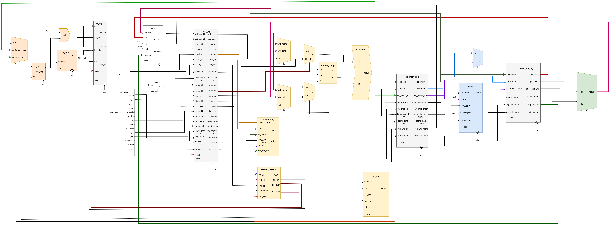

# RISC-V 5-Stage Pipelined CPU

A 32-bit RISC-V processor with a 5-stage pipeline (IF, ID, EX, MEM, WB), implemented in Verilog. It is the pipelined version of the single-cycle CPU. Targets an Intel FPGA (Cyclone V) with Quartus Prime 25.1 Lite and ModelSim.

---

## Datapath



The datapath has four pipeline registers (`if_id_reg`, `id_ex_reg`, `ex_mem_reg`, `mem_wb_reg`). A signal name ends with the stage where the value currently is (`_id`, `_ex`, `_mem`, `_wb`).

---

## Hazard Handling

| Hazard | Solution |
|--------|----------|
| Data hazard (result needed by the next 1-2 instructions) | `forwarding_unit` selects the operand from the MEM or WB stage instead of the register file |
| Load-use hazard | `hazard_detector` stalls PC and IF/ID for one cycle and inserts a bubble into ID/EX |
| Control hazard (branch, JAL, JALR) | Decided in EX (predict not taken). IF/ID and ID/EX are flushed, 2-cycle penalty |
| Register file read and write in the same cycle | `reg_file` bypasses the written value to the read port |

Forwarding from MEM uses `fwd_mem = (wb_sel_mem == 2'b10) ? pc4_mem : alu_result_mem`, because JAL and JALR write `pc+4`.

---

## Project Structure

```
cpu_ricsv_pipeline/
├── rtl/                      # Verilog source files
│   ├── cpu_ricsv_pipeline.v  # Top-level module (wires the 5 stages and 4 registers)
│   ├── if_stage.v            # IF: PC register, PC mux, instruction memory
│   ├── id_stage.v            # ID: controller, register file, immediate generator
│   ├── ex_stage.v            # EX: ALU, branch comparator, forwarding, hazard detection
│   ├── mem_stage.v           # MEM: data memory
│   ├── wb_stage.v            # WB: write-back mux
│   ├── if_id_reg.v           # IF/ID  pipeline register (en, flush)
│   ├── id_ex_reg.v           # ID/EX  pipeline register (flush)
│   ├── ex_mem_reg.v          # EX/MEM pipeline register
│   ├── mem_wb_reg.v          # MEM/WB pipeline register
│   ├── forwarding_unit.v     # Forwarding select (fwd_a, fwd_b)
│   ├── hazard_detector.v     # Stall and flush control
│   ├── controller.v          # Control unit
│   ├── pc_reg.v, INSTR_MEM.v, reg_file.v, IMM_GEN.v
│   ├── alu.v, branch_comp.v, data_mem.v
│   └── mux.v, mux3.v, mux4.v
├── image/                    # Diagrams
└── README.md
```

`data_path.v` and `processor.v` in `rtl/` are left over from the single-cycle design and are not part of the pipeline.

---

## Pipeline Stages

| Stage | Module | What it does |
|-------|--------|--------------|
| IF | `if_stage` | Fetch the instruction, choose the next PC from `pc_sel` (`00` pc+4, `01` branch/JAL target, `10` JALR target) |
| ID | `id_stage` | Decode, read registers, generate the immediate and control signals |
| EX | `ex_stage` | ALU, branch decision (`pc_sel`), forwarding muxes, hazard detection |
| MEM | `mem_stage` | Load and store |
| WB | `wb_stage` | Select the result (`r_data`, `alu_result`, `pc+4`) and write it to the register file |

---

## Supported Instructions

| Type | Instructions |
|------|-------------|
| R-type | `ADD`, `SUB`, `AND`, `OR`, `XOR`, `SLT`, `SLTU`, `SLL`, `SRL`, `SRA` |
| I-type | `ADDI` and other immediate ALU instructions, `LB`, `LH`, `LW`, `LBU`, `LHU`, `JALR` |
| S-type | `SB`, `SH`, `SW` |
| B-type | `BEQ`, `BNE`, `BLT`, `BGE`, `BLTU`, `BGEU` |
| J-type | `JAL` |
| U-type | `LUI`, `AUIPC` |

---

## Simulation

Test program in `INSTR_MEM.v`: `addi`, `sw`, `lw`, `beq` (taken, after a load-use stall), `add`/`sub`, `jal`, `jalr`.

Expected result after 30 cycles: `x1 = 5`, `x2 = 5`, `x3 = 0`, `x4 = 0x20`, `x6 = 7`, `x7 = 0x2C`, `data_mem[0] = 5`.

---

## Build

1. Open the project in Quartus Prime and set `cpu_ricsv_pipeline` as the top-level entity.
2. Run Analysis & Synthesis (Ctrl+K) after every new sequential block. Simulation alone does not catch latch problems.
3. Simulate with ModelSim.

---

## Status

- All five stages and four pipeline registers are done and pass the end-to-end test above.
- Open: pipeline testbench in `test_bench/`, Quartus project cleanup, `INSTR_MEM` still infers latches.
